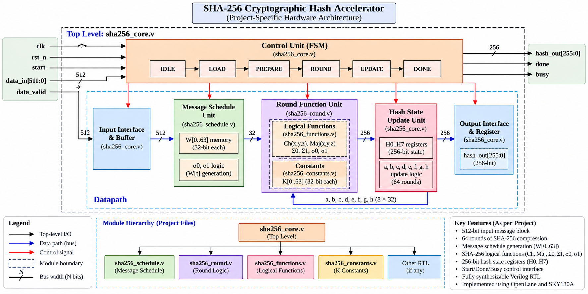

# SHA-256 Cryptographic Hash Accelerator

A Verilog-based SHA-256 hardware accelerator implemented using the OpenLane ASIC design flow and SKY130A standard-cell technology.

## Project Overview

SHA-256 (Secure Hash Algorithm 256-bit) is a cryptographic hash algorithm that processes message data and produces a 256-bit digest. This project explores its hardware implementation through RTL design, simulation, synthesis, physical design, physical verification, and multi-corner Static Timing Analysis (STA).

The objective is to understand how a digital algorithm is translated into synthesizable hardware and implemented through an ASIC design flow.

## Project Overview Video

Watch this short video walkthrough of the SHA-256 Cryptographic Hash Accelerator project, covering the repository structure, architecture overview, Verilog RTL, simulation evidence, synthesis, physical design, verification, and timing analysis.

[**▶ Watch the SHA-256 Accelerator Project Overview**](https://drive.google.com/file/d/1Z9ZSGzI3XoMRDa13Hw8hROHtTih1U9HN/view?usp=drivesdk)

## Architecture Block Diagram

[**View the full-size architecture diagram**](./sha256_accelerator_block_diagram.png)

### Architecture Overview

The diagram illustrates the conceptual organization of the SHA-256 accelerator:

- **Control Unit:** Coordinates the hashing operation and sequences the processing steps.
- **Input Interface:** Accepts the message block for processing.
- **Message Schedule:** Generates the message words required by the compression function.
- **Round Function Unit:** Performs SHA-256 logical operations and compression rounds.
- **Hash-State Update:** Combines the final working variables with the current hash state.
- **Output Interface:** Provides the resulting 256-bit digest.

The RTL source is organized into modules for the core, round logic, message schedule, logical functions, and SHA-256 constants.

*Note: This is a conceptual architecture illustration. The exact module interconnections, state transitions, and signal names must be confirmed against the Verilog RTL before treating the diagram as an exact implementation schematic.*

## ASIC Design Flow

The project follows the following general ASIC implementation sequence:

**RTL Design → Simulation → Synthesis → Floorplanning → Placement → Clock Tree Synthesis → Routing → GDSII**

Physical verification and timing analysis evaluate the implementation at different stages.

| Stage | Purpose |
|---|---|
| RTL Design | Describe the SHA-256 hardware in Verilog |
| Simulation | Evaluate functional behavior using testbenches |
| Synthesis | Convert RTL into a logic netlist |
| Floorplanning | Establish the initial physical layout and core area |
| Placement | Assign physical locations to standard cells |
| Clock Tree Synthesis | Build the clock distribution network |
| Routing | Connect cells through physical interconnects |
| GDSII Generation | Produce the physical layout database |
| DRC and LVS | Check layout rules and compare layout connectivity with a reference netlist |
| Static Timing Analysis | Evaluate timing against the design constraints |

## Repository Structure

| Directory | Contents |
|---|---|
| [`rtl/`](./rtl/) | Verilog design modules |
| [`tb/`](./tb/) | Simulation testbenches |
| [`synthesis/`](./synthesis/) | Synthesis statistics and documentation |
| [`simulation/`](./simulation/) | RTL and gate-level simulation evidence |
| [`physical_design/`](./physical_design/) | Floorplan, placement, CTS, routing, and GDS evidence |
| [`verification/`](./verification/) | Magic DRC and Netgen LVS evidence |
| [`timing/`](./timing/) | Pre-layout and post-route STA results across 16 corners |

## RTL Modules

The design source files are organized as follows:

| File | Intended responsibility |
|---|---|
| `sha256_core.v` | Top-level SHA-256 core |
| `sha256_round.v` | Round computation logic |
| `sha256_schedule.v` | Message schedule generation |
| `sha256_functions.v` | SHA-256 logical functions |
| `sha256_constants.v` | SHA-256 round constants |

Refer to the source files for the exact implementation details and module connections.

## Tools and Technology

- **HDL:** Verilog
- **Synthesis:** Yosys
- **ASIC implementation flow:** OpenLane / OpenROAD
- **Process technology:** SKY130A
- **Physical verification:** Magic DRC and Netgen LVS
- **Timing analysis:** OpenSTA

## Implementation and Verification Results

The repository contains evidence covering simulation, synthesis, physical implementation, physical verification, and multi-corner timing analysis.

- **Simulation:** RTL and gate-level simulation evidence is provided in the `simulation/` directory.
- **Synthesis:** Yosys synthesis statistics are documented in `synthesis/`.
- **Physical Design:** Floorplanning, placement, CTS, routing, and GDS layout evidence is documented in `physical_design/`.
- **Physical Verification:** Recorded Magic and Netgen results are documented in `verification/`.
- **Timing Analysis:** Pre-layout and post-route results across 16 corners are documented in `timing/`.

### Timing Limitations

The recorded multi-corner timing reports include negative slack at multiple corners, indicating timing violations against the applicable constraints. Therefore, the existence of a routed layout or generated GDSII file does not establish timing closure or complete ASIC signoff.

DRC and LVS results must also be interpreted in the context of the exact layout, reference netlist, technology files, and rule configurations used for each run.

## Project Scope

This project demonstrates a practical Verilog-to-ASIC implementation workflow using an open-source toolchain and the SKY130A technology. It provides an opportunity to study the relationship between RTL architecture, synthesized logic, physical implementation, verification, and timing behavior.

## Project Information

- **Project:** SHA-256 Cryptographic Hash Accelerator
- **Design language:** Verilog HDL
- **Target technology:** SKY130A
- **ASIC flow:** OpenLane
- **Repository:** [SHA-256 Cryptographic Hash Accelerator](https://github.com/Moursagna/SHA-256-Cryptographic-Hash-Accelerator)

