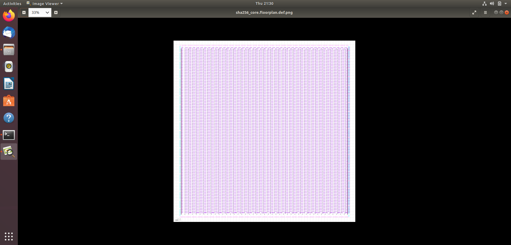
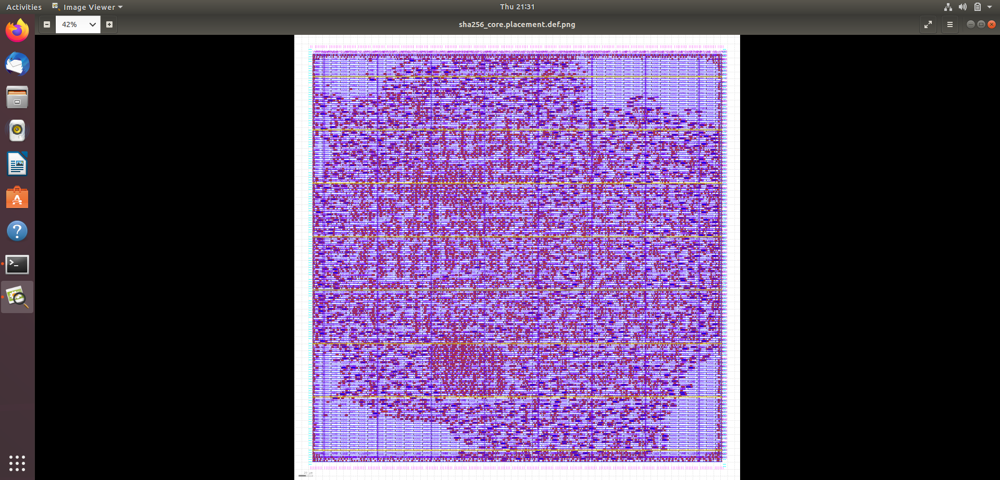
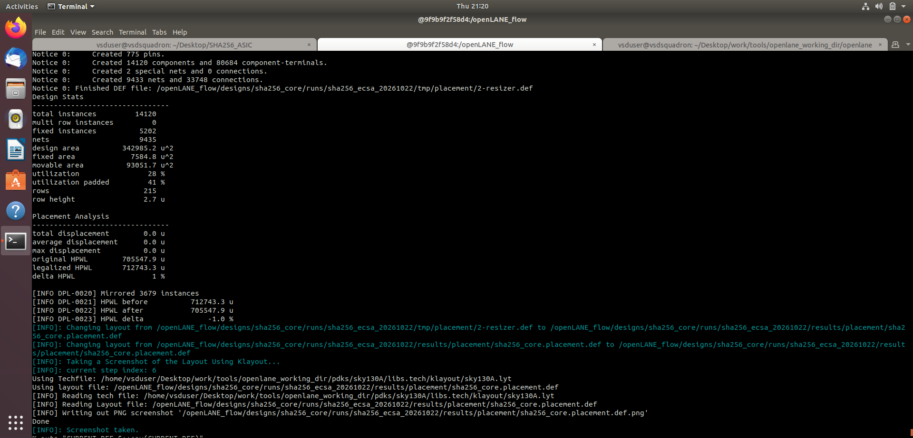
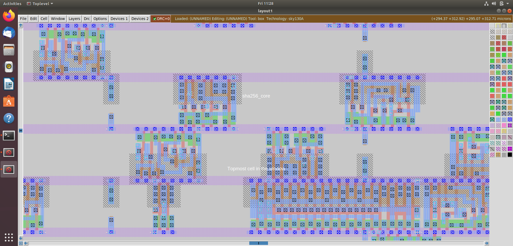
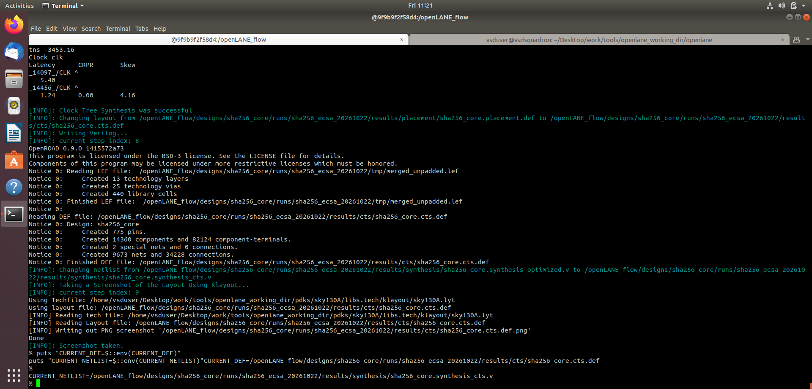
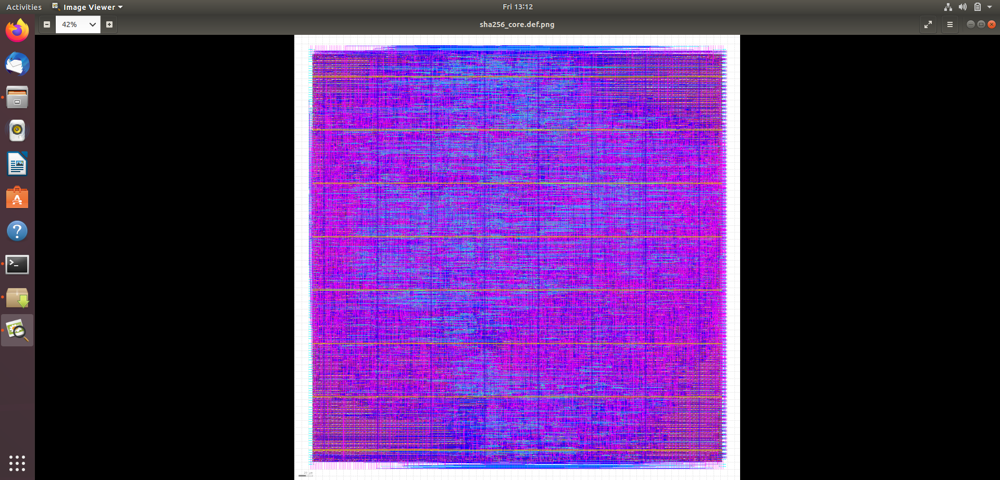
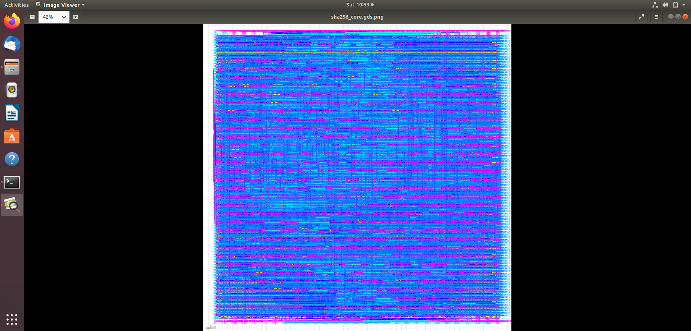

# SHA-256 Accelerator — Physical Design

## 1. Floorplanning

Floorplanning establishes the initial layout area and arrangement of the design.

[View Floorplan](sha256_floorplan.png)

## 2. Placement

Placement assigns standard cells to physical locations on the chip.

[View Placement Layout](sha256_placement.png)

[View Placement Report](sha256_placement_report.png)

## 3. Clock Tree Synthesis (CTS)

CTS builds the clock distribution network to deliver the clock to sequential elements.

[View CTS Layout](sha256_cts_layout.png)

[View CTS Report](sha256_cts_report.png)

## 4. Routing

Routing connects the placed standard cells using physical interconnect metal layers.

[View Routed Layout](sha256_routed_layout.png)

## 5. GDSII Layout

GDSII represents the physical layout database used for downstream fabrication preparation.

[View GDS Layout](sha256_gds_layout.png)

## Implementation Flow

**Floorplanning → Placement → CTS → Routing → GDSII**

The layout and reports provide evidence of implementation stages. Physical verification and timing analysis must be evaluated separately before making signoff claims.

**Flow:** OpenLane  
**Target technology:** SKY130A
