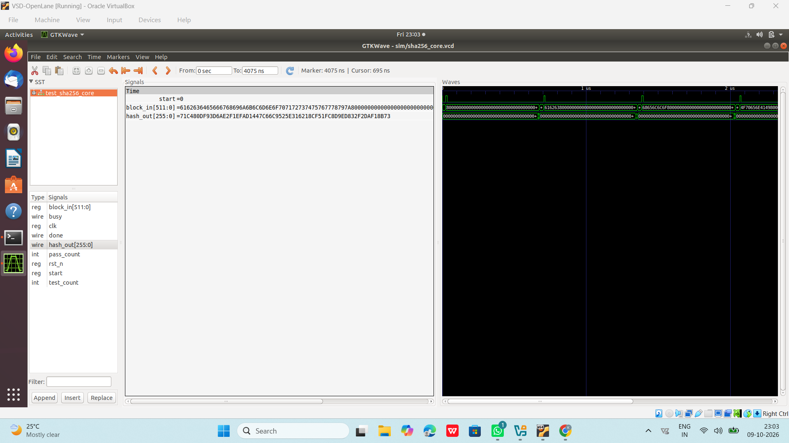
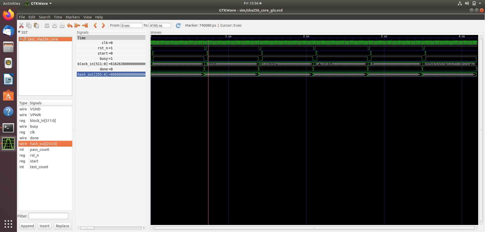

# SHA-256 Accelerator — Simulation Results

This section presents functional simulation evidence for the SHA-256 hardware accelerator.

## 1. RTL Simulation

The RTL testbench verifies the behavior of the SHA-256 core at the register-transfer level.

**Image:** `sha256_rtl_simulation_waveform.png`

## 2. Gate-Level Simulation

The gate-level simulation waveform provides evidence from the synthesized logic-level design.

**Image:** `sha256_gate_level_simulation_waveform.png`

## Notes

- RTL and gate-level simulation are distinct verification stages.
- Review the testbench output and expected hash values alongside these waveforms when assessing functional correctness.
- A waveform screenshot alone does not establish complete verification coverage.

