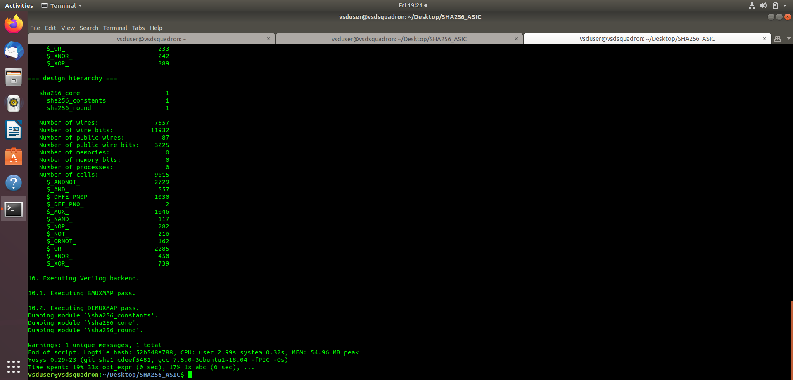

# SHA-256 Accelerator — Synthesis

## Overview

Logic synthesis converts Verilog RTL into a logic-level netlist through optimization and technology mapping. This project uses Yosys and targets SKY130A.

## Synthesis Results

**Synthesis Screenshot:** [View Yosys Synthesis Cell Statistics](yosys_synthesis_cell_statistics.png)

The screenshot shows the reported synthesis statistics for the SHA-256 core.

- **Reported hierarchy:** 9,615 cells.
- **Cell statistics:** Summarize the synthesized logic structure.
- **Note:** Generic Yosys cell counts do not represent the final SKY130 standard-cell count.

## ASIC Flow

**RTL → Synthesis → Technology Mapping → Physical Design → GDSII**

**Tool:** Yosys  
**HDL:** Verilog  
**Target technology:** SKY130A
