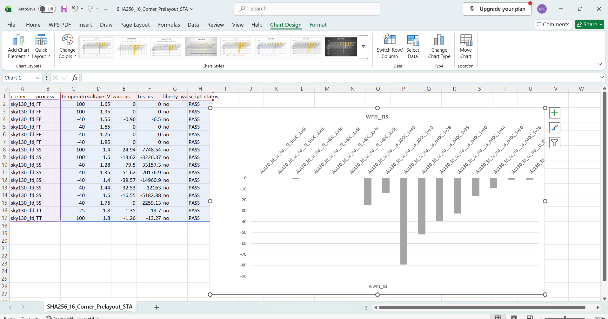
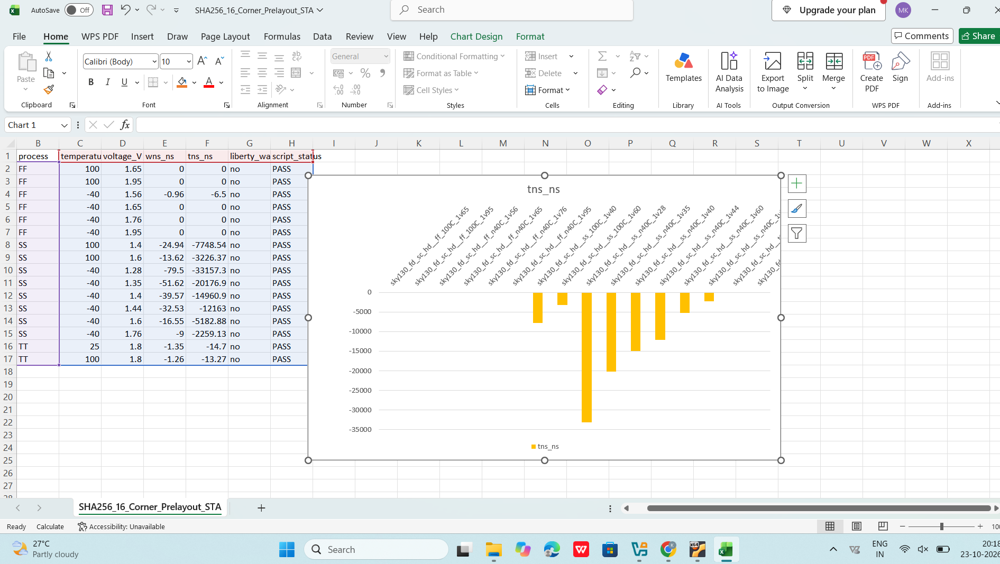
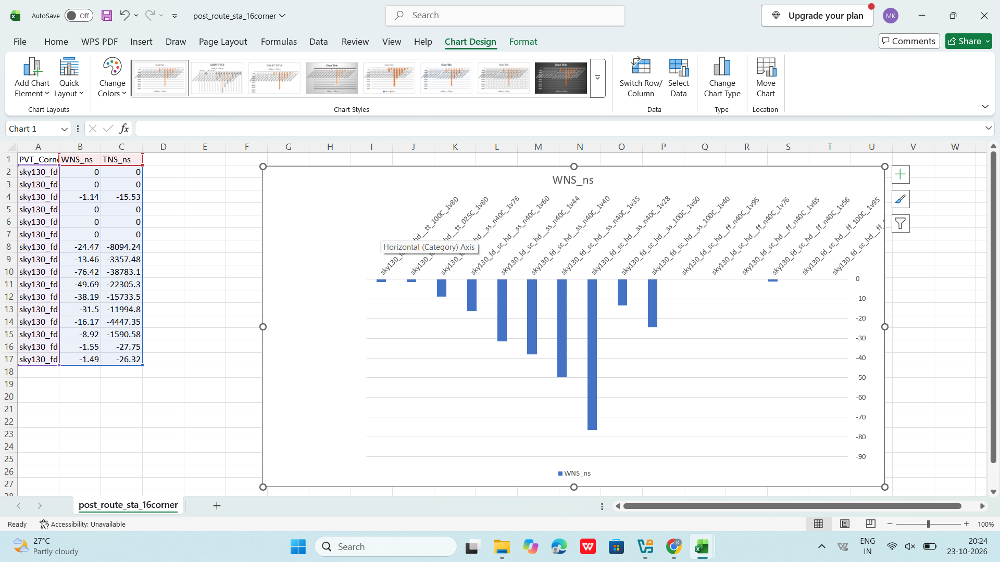
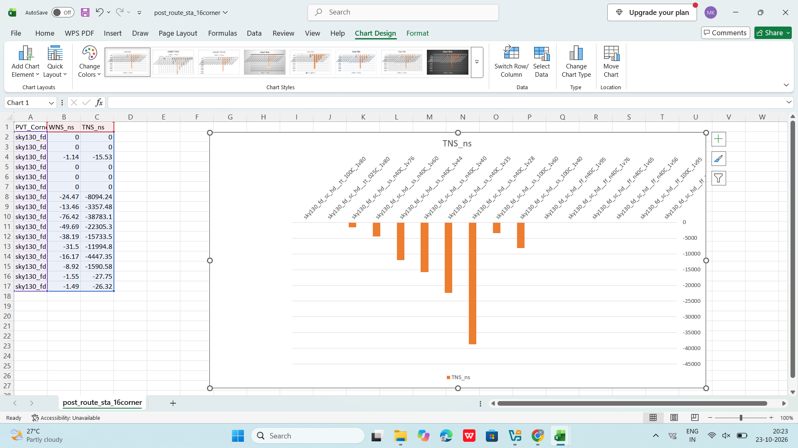
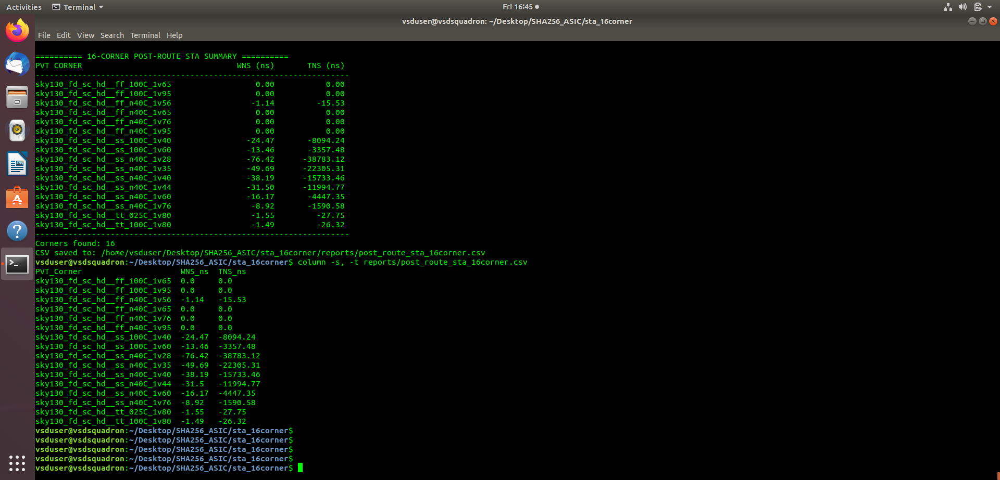

# SHA-256 Accelerator — Static Timing Analysis

## 1. Pre-layout STA

Pre-layout Static Timing Analysis evaluates timing using the synthesized design and the available timing constraints before physical routing parasitics are incorporated.

### Worst Negative Slack (WNS)

[View Pre-layout WNS — 16 Corners](pre_layout_sta_wns_16_corners.png)

### Total Negative Slack (TNS)

[View Pre-layout TNS — 16 Corners](pre_layout_sta_tns_16_corners.png)

WNS identifies the worst timing slack, while TNS summarizes negative slack across violating timing paths. Results must be evaluated against the timing constraints and the selected process, voltage and temperature (PVT) corners.

## 2. Post-route STA

Post-route STA evaluates timing after physical implementation, using routing parasitics when correctly extracted and annotated.

[View Post-route WNS — 16 Corners](post_route_sta_wns_16_corners.png)

[View Post-route TNS — 16 Corners](post_route_sta_tns_16_corners.png)

[View Post-route STA Terminal Report](post_route_sta_terminal_report.png)

## Timing Assessment

Timing results must be interpreted across all analyzed corners. Negative slack indicates timing violations relative to the applicable constraints; successful physical implementation does not automatically mean timing closure.

**Analysis:** Static Timing Analysis  
**Target technology:** SKY130A
