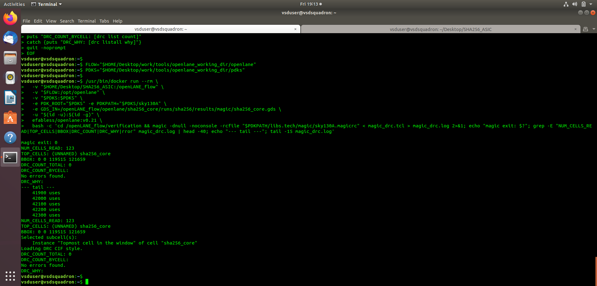
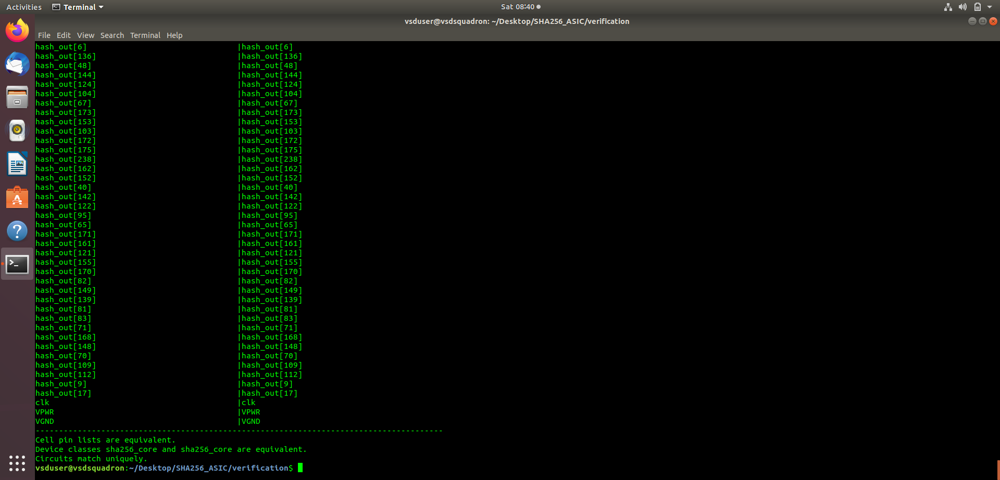
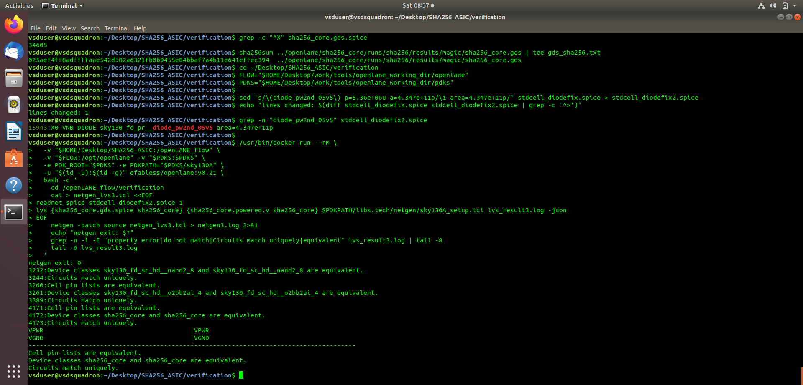

# SHA-256 Accelerator — Physical Verification

## 1. Design Rule Check (DRC)

DRC checks the physical layout against the geometric and connectivity-related rules defined by the technology's verification deck.

[View Magic DRC Results](magic_drc_zero_violations.png)

The recorded Magic run reported **zero DRC violations**. This result applies to the specific layout and rule configuration used for that run.

## 2. Layout Versus Schematic (LVS)

LVS compares the extracted layout netlist against the reference circuit netlist to check whether their circuit structures match.

[View Netgen LVS Match Summary](netgen_lvs_match_summary.png)

[View Detailed LVS Evidence](netgen_lvs_detailed_evidence.png)

The recorded Netgen comparison reported that the netlists matched. Final conclusions depend on verifying that the compared files correspond to the intended final design.

## Verification Summary

- **DRC tool:** Magic
- **LVS tool:** Netgen
- **Target technology:** SKY130A

DRC and LVS address different aspects of physical correctness. Neither result alone establishes timing closure or complete ASIC signoff.
